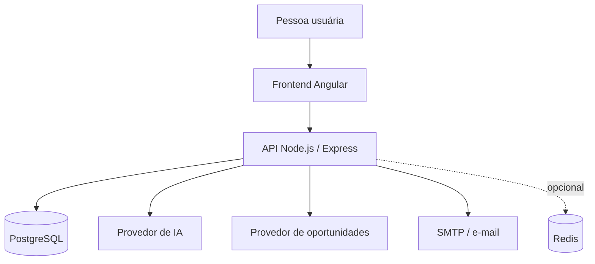

# Arquitetura da aplicação

## Visão geral

O repositório separa a aplicação em frontend e backend, com persistência relacional e integrações externas configuradas por variáveis de ambiente.



O diagrama é conceitual. Integrações opcionais dependem das variáveis de ambiente e da configuração de implantação.

## Frontend

**Diretório:** `frontend/`

Tecnologias identificadas no `package.json`:

- Angular 18
- TypeScript
- RxJS
- Angular Router e Angular Forms
- Tailwind CSS na cadeia de desenvolvimento
- Jasmine e Karma para testes

O ponto de entrada das rotas é `frontend/src/app/app.routes.ts`. A aplicação também possui diretórios dedicados a componentes, guards, interceptors e modelos.

Comandos comuns:

```bash
cd frontend
npm ci
npm start
npm run build
npm test
```

O script de testes inicia o runner Angular/Karma; em ambientes de CI, utilize a configuração headless descrita em [GitHub Actions](github-actions.md).

## Backend

**Diretório:** `backend/`

Tecnologias e bibliotecas identificadas:

- Node.js e Express
- PostgreSQL via `pg`
- JWT para autenticação
- bcrypt para hash de senhas
- Helmet e CORS
- express-rate-limit
- Redis e rate-limit-redis como recursos opcionais
- node-cron para tarefas agendadas
- Nodemailer para e-mail
- Jest e Supertest para testes

Arquivos importantes:

- `backend/src/server.js`: inicialização do servidor.
- `backend/src/app.js`: configuração da aplicação Express.
- `backend/src/database/`: acesso e migrações do banco.
- `backend/src/modules/`: funcionalidades organizadas por domínio.
- `backend/src/middlewares/`: middlewares compartilhados.
- `backend/src/jobs/`: tarefas agendadas.

Comandos comuns:

```bash
cd backend
npm ci
npm run dev
npm test -- --runInBand
npm run lint
npm run migrate
```

## Persistência

O banco principal é PostgreSQL. O arquivo `docker-compose.yml` define um serviço PostgreSQL 16 e um volume persistente para desenvolvimento local.

Não use credenciais de desenvolvimento em ambientes públicos. Em produção, configure credenciais fortes, TLS quando suportado e permissões mínimas.

## Integrações configuráveis

O arquivo `backend/.env.example` documenta variáveis para:

- banco PostgreSQL;
- segredo e validade do JWT;
- provedor de IA;
- provedor de oportunidades;
- e-mail via SMTP;
- Redis;
- agendamento de tarefas;
- integração de pagamentos.

Uma variável no exemplo não significa que a integração esteja habilitada em todos os ambientes. Confira a configuração de execução e os logs ao investigar uma integração.

## Fronteiras de responsabilidade

- O frontend apresenta a experiência e envia requisições à API.
- O backend deve validar entradas e autorizar operações, sem confiar em validações exclusivamente client-side.
- Segredos de provedores devem permanecer no backend.
- O banco é a fonte persistente dos dados da aplicação.
